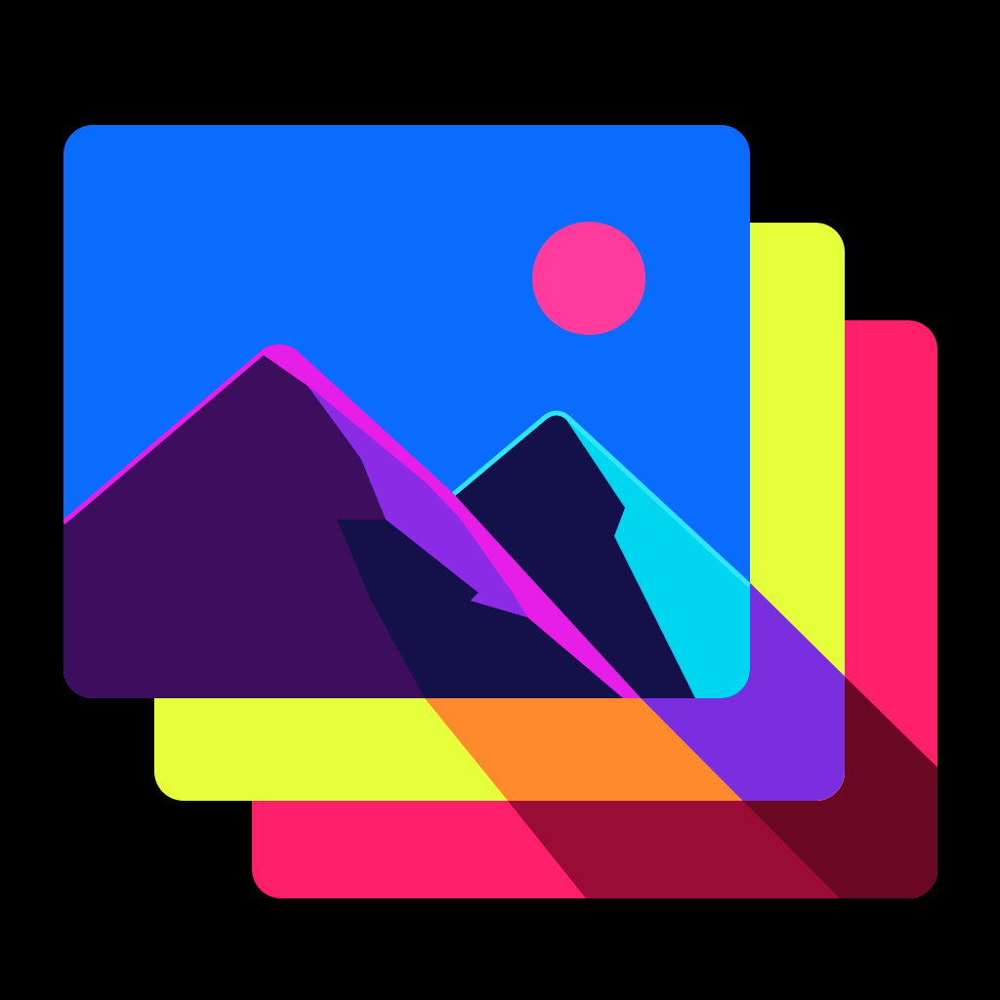

<p align="center">
  
</p>

<h1 align="center">PaperWall3D</h1>

<p align="center">
  Turn any photo or artwork into a depth-aware <b>3D parallax wallpaper</b>, entirely in your browser.
</p>

<p align="center">
  
  
  
  
</p>

PaperWall3D runs AI models locally to find the main subject, estimate scene depth, separate the image into layers and rebuild it as lightweight 2.5D geometry. You tune depth, relief, segmentation, lighting and camera motion in a live 2D parallax view and a 3D camera view with a Blender-style interface, preview the wallpaper in a desktop frame, then export a live HTML wallpaper, a GLB or a reusable config.

**No server, no uploads.** Your images and the model inference stay on your device.

## How it works

The flow follows 2.5dwallpp: open an image, land on the live **2D Parallax** view, check the two AI stages, then preview and export.

| Step | What happens |
| --- | --- |
| **1. Open** | Load a JPG, PNG or WebP (open, drag and drop, or a recent project). The image is resized to the working resolution (default 1600 px). |
| **2. 1 · Object mask** | U²-NetP (fast, default) or U²-Net (accurate) finds the main object. Threshold, grow/shrink, feather, edge cleanup, flip-average, zoom-in pass and **Pick Object** shape the mask. |
| **3. 2 · Object depth** | Depth Anything V2 Small estimates depth for the whole image (a heuristic fallback works offline). The object depth is its masked, edge-cleaned part. |
| **4. Layers** | The object is cut out (defringed), the hole behind it is inpainted, and the result is a background plane plus an object layer. |
| **5. 2D Parallax** | You land here at stage **Result**: a live WebGL parallax wallpaper that follows the cursor (on touch devices, the gyro). Tune strength, focus, tilt, lighting, background plane depth and object relief. |
| **6. 3D Camera** | An orbit view of the displaced meshes for inspection and the GLB export. |
| **7. config.json** | Every setting as commented JSON in a code editor, live two-way synced with the sliders. |
| **8. Wallpaper Preview, then export** | A full-window preview in a desktop frame (with an optional clock overlay). Every export (live HTML wallpaper, GLB, PNG, config.json, `.pw3d.json`) goes through it first. |

AI inference runs only when a model setting changes. Mask and depth post-processing settings re-split the cached model output (about half a second, no model run), and parallax, layers and 3D camera settings are instant GPU updates.

### Workflow

1. **Open** an image: you land on **Result**.
2. **Mask.** Use *Show stage ▸ 1 · Main object mask*. Fix it with *Pick Object*, the threshold, grow/shrink, zoom-in pass or flip-average.
3. **Depth.** Use *Show stage ▸ 2 · Object depth*. Try invert, gamma or the clip percentiles.
4. Back to **Result**, then tune **Parallax** (strength, tilt, relief, background plane depth, lighting).
5. **Judge** it: move to all four corners, or turn on auto motion.
6. **3D Camera** is for inspection and the GLB; tune the look in 2D.
7. **Preview Wallpaper**, then **export**.

A subtle hint in the viewport walks you through these steps for the first image of a session (dismiss it with the x).

### Presets

The list icon on the **Parallax** panel header (and *Open Image as Portrait / Product / Landscape / Illustration* on the splash screen) applies a starting-point preset for that kind of image. It is one undo step, and you refine from there.

## Features

- **Blender-style UI.** Dark theme, top bar with menus and workspaces (Layout, 1 · Mask, 2 · Depth, 3D Camera, Config, Export), a viewport header with the **2D Parallax | 3D Camera | config.json** switch, a **Show Stage** menu, **Pick Object** and **Preview Wallpaper**, an outliner, a properties editor that mirrors 2.5dwallpp's settings panel, an image strip with the pipeline layers, and a status bar with job progress.
- **Stages.** *Result*, *1 · Main object mask*, *2 · Object depth (masked)* and *Whole-image depth*, from the header, the outliner, the image strip or the **Z pie menu**.
- **Pick Object (P).** Shows the untilted original; click the object you want. Esc cancels, the x clears the pick.
- **config.json editor.** The 2.5dwallpp-compatible document (sections `parallax`, `layers`, `mask`, `depth`, `camera3d`) with a `//` comment above every key (range, step, options, default). Edits apply live. `//` comments, trailing commas and flat keys are accepted, out-of-range values are clamped and reported by path, and syntax errors show line and column. **Copy** keeps the comments, **Download** writes plain JSON, **Defaults** resets.
- **Wallpaper Preview.** Frame aspect (this screen, 16:9, 16:10, 21:9, 32:9, phone, square), live cursor parallax, optional desktop clock overlay, and an export bar that hides when idle: **Save Live Wallpaper (.html)**, **Export GLB**, **Save PNG**, **Save config.json**, **Save .pw3d.json**.
- **Live HTML wallpaper.** One self-contained `.html` with the parallax shader and the layers embedded (no external requests): mouse, then auto motion when idle, gyro on phones. It works in Wallpaper Engine, Lively or any browser.
- **Projects.** Saved to IndexedDB with the analysis cached, so reopening a project skips the AI step.
- **Import.** Accepts a `.pw3d.json` (version 1 or 2) or a bare 2.5dwallpp `config.json`.
- **Blender interactions.** Drag sliders (Ctrl snaps to steps, Shift gives fine control) or click to type; **F3** searches every operator; **Z** opens the view pie; **N** toggles the sidebar; Ctrl+Z / Ctrl+Shift+Z undo and redo. Mask and depth sliders apply when you release them.

### Compatible with 2.5dwallpp

The `config.json` sections, key names, ranges and defaults are the same as in 2.5dwallpp (the one exception is the default mask model, U²-NetP here, and the extra `depth.model` key), so a config can be pasted into either app. GLB exports use the same layout (image height 1, `z = (depth - 0.5) * zscale`, meshes named `background` and `object`, unlit double-sided materials).

## Brand

The logo shows three stacked photo cards with long shadows, standing for an image peeled into layers. The UI theme is built from the same palette: Blender's layout and density, recoloured neon-on-black.

| Swatch | Hex | Used for |
| --- | --- | --- |
|  | `#0a6cff` | Primary accent: selection, sliders, active tools, progress |
|  | `#ff1f6b` | Active highlight: active object, workspace tab, version badge |
|  | `#ff3c9e` | Sun, foreground wireframe |
|  | `#e6ff3b` | Warnings, sparing highlights |
|  | `#e61ee8` | Secondary highlights, ridge lines |
|  | `#2fe6ff` | Info and success reports |
|  | `#14104a` | Base hue of the dark, indigo-tinted neutrals |

The logo lives in [`public/logo.svg`](public/logo.svg) (on black) and [`public/favicon.svg`](public/favicon.svg) (transparent, cropped).

## Technology

| Area | Stack |
| --- | --- |
| AI inference | ONNX Runtime Web: WebGPU when available, otherwise multi-threaded WASM, in Web Workers |
| Segmentation | U²-NetP / U²-Net |
| Depth | Depth Anything V2 Small (fp16 on WebGPU, int8 on WASM) |
| Image processing | Canvas API and TypedArrays: separable blurs, morphology, connected components, guided filter, push-pull inpainting |
| 3D | Three.js, custom GLSL layer shaders, CPU-displaced geometry, GLTFExporter |
| Persistence | Cache Storage (model files), IndexedDB (projects and analysis), localStorage (UI layout and preferences) |
| Build | Vite and TypeScript (vanilla, no UI framework) |

### Models

Model weights are downloaded from the Hugging Face CDN the first time they are needed, then cached in the browser (Cache Storage). Nothing else is ever sent anywhere. You can see or clear the cache under **Properties › System › Models**.

| Model | Size | License |
| --- | --- | --- |
| U²-NetP (default) | ~4.6 MB | Apache-2.0 |
| U²-Net (optional) | ~176 MB | Apache-2.0 |
| Depth Anything V2 Small | ~27 MB (int8) / ~50 MB (fp16) | Apache-2.0 |

The ONNX Runtime WASM binaries are self-hosted with the app, so no third-party CDN is used for runtime code.

## Getting started

```bash
npm install
npm run dev        # http://localhost:5173
npm run build      # type-check + production build into dist/
npm run preview    # serve the production build
```

Requires Node 20 or newer. Use a recent Chromium, Firefox or Safari. WebGPU is optional; without it inference runs on WASM.

## Deploying to Netlify

The repo is ready for Netlify. `netlify.toml` sets the build command, the publish directory, and the cross-origin isolation headers (`COOP: same-origin`, `COEP: credentialless`) that multi-threaded WASM needs.

```bash
netlify init       # link or create a site
netlify deploy --build --prod
```

Or connect the repository in the Netlify dashboard; no extra settings are needed.

## Keyboard shortcuts

| Shortcut | Action |
| --- | --- |
| Ctrl+O | Open image |
| Ctrl+S | Save project to the browser |
| Ctrl+Shift+O | Import a `.pw3d.json` or `config.json` |
| P | Pick Object |
| F / Ctrl+Shift+P | Preview Wallpaper |
| F11 / Ctrl+Space | Wallpaper Preview in browser fullscreen |
| Esc | Cancel Pick Object, leave the Wallpaper Preview |
| Ctrl+E | Export GLB (via the Wallpaper Preview) |
| F12 | Render PNG (via the Wallpaper Preview) |
| Ctrl+Shift+S | Export `.pw3d.json` (via the Wallpaper Preview) |
| Shift+R | Re-analyze |
| F3 | Operator search |
| Z / right-click (2D) | View / stage pie menu |
| N | Toggle sidebar |
| Home | Reset view |
| Alt+1…6 | Workspaces: Layout, 1 · Mask, 2 · Depth, 3D Camera, Config, Export |
| Ctrl+Z / Ctrl+Shift+Z | Undo / redo |

## Project structure

```
src/
  core/         shared contracts (types), settings store, defaults, events
  ai/           model registry, model cache, inference worker, pipeline facade
  imaging/      TypedArray image ops + reconstruction worker
  render/       Three.js renderer, displacement meshes, camera rig, export
  ui/           Blender-style shell, widgets, panels, menus, operators
  persistence/  IndexedDB projects, wallpaper config, preferences
  app.ts        orchestration: image → analyze → reconstruct → render
```

## Known limitations

- The inpainting fills smoothly, so it does not continue structures (planks, text) behind the subject. Large parallax can reveal the filled area.
- Depth is *relative* monocular depth, so it is shaped for perception rather than measurement.
- Mask brush editing is not available yet (use Pick Object and the mask settings).

## License

MIT © subham-chaudhary. Model weights are under their own licenses (see above).
